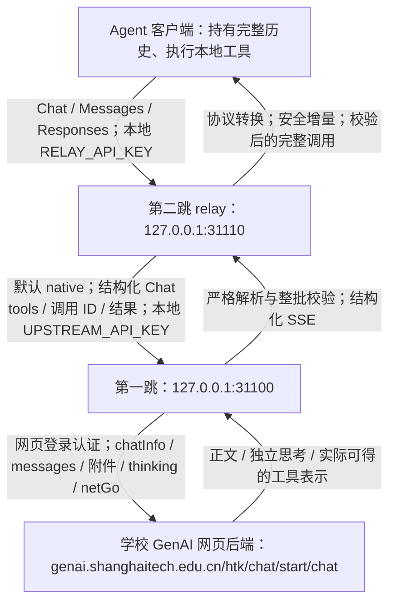
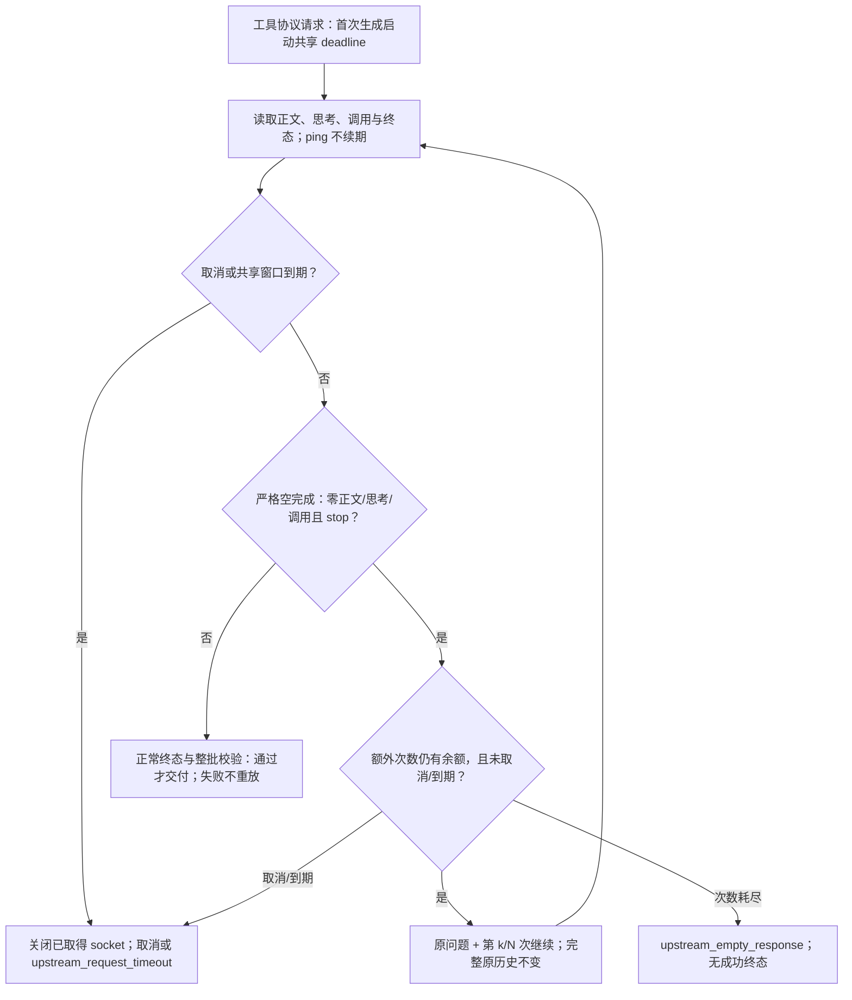

# 原生优先阶段说明：两跳链路与重构边界

本文记录 `feat/native-first-streaming` 阶段的当前实现契约，包括多次空继续预算与共享生成时限。最初重构实现基线分别为根仓库 `a7b3186`、relay 仓库 `44639ec`；“重构前”指这两个实现提交之前的版本。第七、八节保留此前长测与一次继续修复历史；本次预算版本已经重启并完成正式双跳复测，当前部署与实测结论见第九节。

## 1. 当前采用的路线



“第一跳/第二跳”沿用项目命名，不是按客户端请求经过的先后编号。第一跳自身也提供三种兼容 API，可以独立接客户端；**本阶段两跳路径中，relay 只通过第一跳的 Chat Completions 接口通信**。

因无法申请独立 API Key，本阶段明确放弃学校独立官方 API（`genaiapi.shanghaitech.edu.cn`）路线，不提供远程 base 示例、申请指南或绕过网页第一跳的直连方案。这一决策不删除本地 `UPSTREAM_BASE_URL`，也不把 `UPSTREAM_TOOL_MODE=native` 改为 `text`。

认证是三个不同边界：学校网页 JWT／账号认证由第一跳的 [`TokenManager`](auth/token_manager.py) 管理；relay 的 `UPSTREAM_API_KEY` 应对应第一跳本地代理 Key；客户端使用 `RELAY_API_KEY` 访问 relay。后两者不是学校独立 API Key。未配置本地 Key 不等于具备安全隔离，服务应限制在受信网络。

## 2. 每层做什么、不做什么

### 客户端：持有工作状态并真正执行工具

客户端发送模型 ID、系统指令、完整历史、工具 Schema、选择/并行约束以及附件。收到完整且校验通过的 `tool_calls`、`tool_use` 或 `function_call` 后，由客户端按自身权限执行 Read/Write/Edit/Bash 等工具，再携带同一调用 ID 回传结果。两层代理都不会执行模型提出的命令，也不会因为参数里出现路径就读取本地工作文件。

代理没有可恢复的服务端会话存储；Responses 的 `previous_response_id`、`item_reference`、`store=true` 不能替代完整历史。调用格式正确只是传输条件，不是执行授权，也不证明写出的代码或文件内容正确。

### 第二跳：统一协议，尽量不丢结构

- **请求与历史**：三种入口转换为 `RelayRequest`。默认 native 保留 system/developer 角色、assistant 历史调用、原调用 ID、tool 结果及 `is_error`；Messages 的 `tool_use_id`、Responses 的 `call_id` 转成对应 Chat 关联字段，不按结果顺序猜归属。模型 ID 不由 relay 猜测映射。
- **工具**：普通函数保留名称、Schema 和可表达的 strict 标记。custom text 工具包装为参数 `{"input": string}` 的上游函数；Responses namespace 内部使用 `namespace.leaf`，返回时拆回 namespace/name。custom grammar 和不支持的托管工具不是静默降级，而是拒绝。
- **附件**：保留文本、图片、文档内容块及工具结果中的附件，转换外壳而不把 base64 展开成提示词正文；真正网页上传由第一跳完成。
- **思考**：将客户端可表达的 thinking/reasoning 设置映射为第一跳布尔开关；历史思考及元数据在 Chat 可表达的字段中保留。保留字段不等于网页会消费它们，更不等于跨供应商加密思考状态可以恢复。
- **搜索**：识别支持的 web_search 声明，转为第一跳搜索选项，而不是交付为客户端本地函数，也不伪造供应商托管搜索生命周期。
- **输出**：立即消费第一跳 SSE；正文与独立思考增量向下传递，工具参数等待终态后整批校验。适配为客户端要求的协议，不把第一跳已经解析的调用再次退化成文本再猜一次。

关键实现：[`prepare_chat`](genai2agent-relay/relay/normalize.py)、[`prepare_messages`](genai2agent-relay/relay/messages.py)、[`prepare_responses`](genai2agent-relay/relay/responses.py)、[`request_options`](genai2agent-relay/relay/features.py)、[`ActionRelay.stream` / `_prepare_messages`](genai2agent-relay/relay/engine.py)、[`UpstreamClient._payload` / `stream`](genai2agent-relay/relay/upstream.py)。

### 第一跳：适配网页协议，而不是冒充学校原生函数 API

1. Chat 入口先检查工具定义与约束，再用 `inject_tool_prompt` 将工具提示放在最新 user 轮附近。`normalize_tool_history` 把历史 assistant 调用写成带 ID 的 action 封套，把 tool 结果写成含 `call_id/output/is_error` 的已执行结果上下文；用户/结果中的控制标记作可逆转义，附件内容不因此改写。
2. `prepare_request` 处理附件与网页选项。最新 user 的文本成为 `chatInfo`，其余规范化消息成为 `messages`；请求模型名作为 `aiType`，元数据用于取得 `rootAiType`。不会凭空把网页端点变成接受标准 `tools` 的函数接口。
3. 当前轮图片以原 URL/data URL 放入 `imageUrls`；历史图片保留在该轮多模态消息。文档上传到网页业务接口：当前轮以同一请求会话的 `fileIds` 引用，历史文档以平台解析文本恢复上下文。每轮重新处理随请求携带的附件，没有附件缓存、`/v1/files` 或持久 `file_id` 存储。附件预处理发生在第一跳开始 SSE 之前，因此开始事件并不保证附件准备零等待。
4. 思考参数只控制布尔 `thinking`，不能实现不同 effort 档位或精确推理预算；独立 `reasoning`/`reasoning_content` 才映射为客户端思考字段，不凭正文语义猜测。搜索映射为 `netGo`，正文引用保留，额外查询的链接单独标为“补充检索结果（独立于正文引用编号）”；补充查询失败保留已有正文，不编造引用对应关系。
5. 网页返回结构化 `tool_calls` 时优先保留；否则从明确闭合的 Kimi XTML、DeepSeek DSML、XML 或 action 封套中严格提取。代码引用和 `<think>` 中的示例不是执行通道；不从裸 JSON 或函数样式文本猜调用，不修补引号、标签、参数名或类型。

关键实现：[`chat_completions`](api/chat.py)、[`inject_tool_prompt` / `normalize_tool_history`](tools/prompts.py)、[`prepare_request` / `search_sources`](provider/features.py)、[`split_history_messages` / `_iter_genai_stream`](provider/genai.py)、[`extract_tool_calls`](tools/parsing.py)、[`parse_kimi_output`](tools/kimi.py)。

## 3. native 与 text 的准确含义

| 项目 | 默认 `native` | 显式 `text` |
| --- | --- | --- |
| relay → 第一跳 | 标准 Chat 工具字段、结构化历史、流式调用字段 | 普通对话文本，工具定义/调用/结果编码为文本 |
| 系统与开发者指令 | relay 保留角色 | relay 转为普通上下文 |
| 工具历史 | 保留调用 ID、tool 角色与关联字段 | 封套保留 ID，结果按 ID 关联；附件仍保留 |
| 当前工具协议 | 由第一跳负责网页提示/解析 | relay 要求单个最终 `@@ACTION@@…@@END_ACTION@@` 封套 |
| relay 生成重试 | 不自动降级或重放模型生成 | 只有明确尝试了坏封套且尚未交付正文/思考时，才可按预算请求重写 |
| 适用范围 | 当前本地第一跳，两个仓库一起升级 | 明确只有文本能力的后端；不是 native 出错后的自动补救 |

这里有两种不同的“原生”：**relay 与第一跳之间的原生结构化传输**，以及**模型实际输出的结构化字段或 Kimi/DeepSeek 原生标记**。二者都不证明学校网页开放了原生函数输入。此前向网页直接附加 `tools/tool_choice` 的 DeepSeek、Kimi 短探针均未返回结构化工具字段；它们只是当时的负面样本，不是所有模型/场景的完备能力证明。

## 4. SSE 生命周期、终态与取消

### 正常完成

1. relay 在模型完成前发出协议开始事件：Chat 的 assistant role chunk；Messages 的 `message_start`；Responses 的 `response.created`、`response.in_progress`。第一跳自己的流式接口也先开始，再读取网页输出。
2. 第一跳 `heartbeat_events` 在等待期间以 10 秒间隔产生心跳，通过有界队列桥接读取线程。relay 转发上游心跳：Chat/Responses 使用 SSE 注释，Messages 使用 `ping`，没有另开定时心跳线程。心跳只说明流仍连通，不表示模型产生了有效答案，也不延长生成总时限。
3. 安全正文与独立思考持续交付；潜在工具标记跨 chunk 时留存前缀，发现真实工具区域后缓存，不把半截参数漏成可执行调用。
4. 第一跳确认网页终态、严格解析并校验整批调用后才输出结构化工具事件。relay 的 `UpstreamClient.stream` 还要求第一跳同时有 `finish_reason` 与 `[DONE]`，调用索引连续、调用终态一致；`ActionRelay` 再检查完整批次。
5. 校验通过后，relay 发出完整工具事件，再成功结束：Chat 的 finish chunk + `[DONE]`；Messages 的完整块及 `message_delta`/`message_stop`；Responses 的 item/arguments done 与 `response.completed`。Responses 的 `sequence_number` 单调递增，生命周期内 ID 稳定。协议可能使用名为 delta 的参数事件，但其中工具参数已经整体校验，不是允许执行的半成品。

### 校验、错误与截断

- 入口拒绝不合法请求；输出同时检查工具白名单、JSON Schema、重复 JSON 键、非有限数、重复 ID、`none/required/指定工具` 与禁止并行约束。任意坏成员使整批失败，不删除坏成员再交付其他调用。Schema 引用仅限本地，不为校验访问外部网络。
- 明确坏封套、多封套、缺标签、提前 EOF、工具参数截断均不能变成成功调用。已经交付的正文无法撤回，但工具不会因此提前执行。
- 已发送响应头后，错误通过 SSE error 传播，不再发送成功终态；relay Responses 还发送 `response.failed`。非流式上游/传输失败返回 502，入口参数错误返回 400。
- 第一跳按本地估算 token 强制输出预算，包含思考；普通文本截断分别为 Chat `length`、Messages `max_tokens`、Responses `response.incomplete`，工具截断报错。**经过 relay 时，当前引擎只接受 `stop/tool_calls` 成功终态；第一跳的 `length` 会变成 relay 错误，不应把直连第一跳的截断行为套用到两跳链路。**
- relay 的 `MAX_ACTION_BYTES` 限制解码后正文、思考和工具有效载荷，也约束单个未闭合 SSE 事件；重复帧元数据/心跳不占工具参数预算。Schema/strict 标记和交付前校验不是生成端 constrained decoding。

### 取消与重试边界

关闭消费流会沿生成器 `finally` 关闭上游响应；第一跳 `StreamControl` 设置取消标志并关闭已取得的实际 HTTP 响应/socket，避免后台继续读取。取消或总时限到期时都执行该清理。尚未收到响应头的 `requests` 阻塞连接不能立即打断：主响应仍按总时限返回失败，worker 待请求返回后关闭资源，不再发起后续继续。不能承诺立即终止学校远端推理，也不能回滚客户端已执行的工具。

**默认 native 链路只在第一跳恢复空完成，relay 不再叠加生成重试，避免两层预算相乘。** 只有启用工具协议恢复（`recover_empty=True`）的请求，且某次生成为**零正文、零思考、零调用、正常 `stop`**，才可使用额外继续预算。默认额外 `N=3`，连同首次最多生成 `N+1=4` 次；`N=0` 只关闭额外继续，`N` 上限为 10。预算耗尽仍为空时，以 `upstream_empty_response` 失败，绝不假报任务已完成。

每次继续保留完整原历史，不追加空 assistant、不重放历史工具；当前问题使用原 `chatInfo` 加上真实的“第 k/N 次”标记和明确继续指令，不累积上一轮的继续提示。不切模型、不降级 text，也不修补参数。已经产生正文或思考、坏 JSON/Schema、解析失败、断流和长度截断均不满足空完成条件，禁止自动重放。

所有这些工具协议请求还共享一个默认 **600 秒上游生成窗口**：从首次上游生成开始计时，不包含此前附件预处理；首次及所有继续共用同一 deadline，不为新一轮或 ping 续期。即使已经输出正文/思考或正在缓存调用，到期也中断并报 `upstream_request_timeout`，不交付尚未完成校验的调用。预算为 0 时仍受该时限；普通无工具请求既不自动空继续，也不施加这个工具请求总时限。



显式 text 模式仍只对尚未交付正文/思考的明确坏封套作有限纠错，不重试空回答、断流、截断、普通示例或工具执行；它不是 native 出错后的兜底。HTTP 401 的网页登录刷新是独立认证恢复，元数据/附件阶段的令牌恢复仍有已知缺口。

### 恢复与时限配置

下列设置属于**第一跳**；在根项目 `.env` 或启动参数中配置，不放进 relay 的 `.env`。

| 第一跳环境变量 | CLI 参数 | 默认值 | 含义 |
| --- | --- | --- | --- |
| `GENAI_EMPTY_CONTINUATIONS` | `--empty-continuations` | `3` | 额外继续次数，整数 `0..10`；0 禁用额外继续，不是总生成次数 |
| `GENAI_TOOL_REQUEST_TIMEOUT_SECONDS` | `--tool-request-timeout` | `600` | 首次生成及所有空继续共享的秒数，必须为有限正数 |

对应 `Config.empty_continuations=3`、`Config.tool_request_timeout_seconds=600.0`；`Config.__post_init__` 拒绝越界/非整数次数、非有限或非正时限，两个配置均拒绝布尔值。CLI 覆盖环境变量，例如：

```bash
pixi run serve --empty-continuations 3 --tool-request-timeout 600
```

不要混淆三种时钟：第一跳 HTTP connect/read timeout（10/300 秒）限制单次网络操作/两次读取间等待；relay 的 `UPSTREAM_READ_TIMEOUT=1800` 也只是其上游 socket 读取间隔；新的 600 秒窗口限制一个工具协议请求的累计上游生成时间；整场 agent 任务则可能由很多请求与本地工具执行组成。网络读到 ping 可避免 read timeout，但不会延长总生成窗口。

更多空继续之所以安全，是因为前一轮没有交付正文、思考或调用，且历史与工具执行权不变；它并不能保证平台下一次不再空返。次数或时间耗尽都会终止当前 HTTP 响应，代理保留真实失败而不伪造成功。agent 层可依据已保存的历史、实际工具结果和错误显式发起新的继续请求；这不是代理无限重试，也不能保证整场任务永不中断。

关键实现：第一跳 [`heartbeat_events` / `StreamControl` / `validated_events`](provider/streaming.py)、[`validate_tool_request` / `validate_tool_calls`](tools/contracts.py)；relay [`validate_native_calls` / `decode_action` / `validate_choice`](genai2agent-relay/relay/actions.py)、[`UpstreamClient.stream`](genai2agent-relay/relay/upstream.py)、[`chat_events` / `message_events` / `response_events`](genai2agent-relay/relay/streaming.py)。

## 5. 与重构前的对照

下表以根仓库 `a7b3186^`、relay 仓库 `44639ec^` 的实现为对照，而不是把旧版描述成完全没有工具或流式支持。

| 维度 | 重构前 | 当前阶段 |
| --- | --- | --- |
| relay 核心接口 | `TextActionRelay` 调用 backend `complete()`，等待整份普通文本回复 | `ActionRelay` 消费 backend `stream()`，默认 native |
| 两跳间工具协议 | relay 把工具定义/历史编成文本，解析最终 action 封套 | relay 向第一跳发送结构化字段，由第一跳单独承担网页文本适配 |
| relay 流式体验 | 核心先收齐结果，下游无法由核心实时获得正文/思考 | 开始事件先发、正文/思考增量传递、工具整批末尾交付 |
| 第一跳解析 | 已支持部分 Kimi/action/DSML；另有宽松 JSON、Python 字面量、裸 JSON/函数样式/围栏猜测、Bash 参数修补等恢复分支 | 保留明确协议，删除猜测/修补分支；优先结构化调用，显式 DSML invoke/parameter 严格解码 |
| 坏调用的处理 | 第一跳部分提取分支会跳过未知工具后继续收集；并非所有入口共用完整批次契约 | 第一跳三种 API 共用 contracts；relay 也做终态整批校验，非法成员不被过滤掉后继续交付 |
| 重试 | 旧 relay 对解析失败可请求重新序列化，对空回复可追加继续提示 | relay native 不重放；第一跳仅对严格空完成按额外次数和共享时限恢复；text 只在未交付内容且明确坏封套时有限纠错 |
| 历史关联 | 文本转换为主，结构保留受旧 `TextMessage(role, content)` 限制 | native 显式保留 tool_calls/tool_call_id 与可表达的思考元数据；网页文本层也保留 ID |
| 工具执行者 | 客户端 | 仍是客户端；代理没有新增执行权限 |
| 网页/附件/搜索依赖 | 依赖学校网页后端；已有附件、搜索、思考功能 | 继续使用同一网页路线，不声称改造为学校官方函数 API |

变化的目标是**少做一次有损文本转换、尽早交付安全增量、失败时不产生不完整调用**，不是承诺所有模型都会正确用工具，也不是用“兼容”掩盖格式错误。

## 6. 不能承诺的边界与证据口径

- 学校网页模型可用性、配额、缓存、速度和稳定性由平台决定。首事件较快只代表协议已开始，不代表模型首字或工具参数已完成；长参数仍需等待完整生成。
- 不保证所有客户端工具、附件格式、模型组合均兼容。custom grammar、服务端 Responses 状态及未实现的托管工具明确不支持。客户端能发送文档块，不等于模型会主动选择正确上传流程。
- 思考可能不返回，或以未标记正文出现；不补造思考。Messages 的 `genai-compat-no-signature` 只是兼容占位，不是真实 Anthropic 签名；Responses 不重建加密 reasoning 状态。
- 用量为本地文本估算，不是供应商真实计费量，也不包含准确视觉 token。精确采样、推理档位与预算不能因接收了某字段就宣称网页支持。
- 严格 Schema 只能证明结构符合声明，不能证明命令安全、复制内容正确或任务完成。重要写入仍须客户端实际运行、独立回读/哈希核验，长文件优先局部编辑。
- 本文前六节是当前源码与协议边界记录；第七、八节是预算升级前的部署、长测与一次继续修复历史。此前的 [Pi 实际验证](PI_REAL_WORLD_VALIDATION.md)、[历史报告](TEST_REPORT_deepseek_pro.md) 不被改写，其旧版结果不自动证明当前版本稳定。

## 7. 历史正式部署与长时工作结论（预算升级前）

以下为此前重构版本在正式 31100/31110 的验收记录，不是本次多次空继续/共享时限版本的部署证明。当时第一跳沿用 0.0.0.0 监听，relay 为 loopback；不将历史进程 ID 当作当前服务身份。

主客户端使用用户已配置的 omp 18.12.6，RPC 状态确认两模型都走 `GenAI` provider 的 `http://127.0.0.1:31110/v1`，不是官方 API。两个模型分别保持连续历史，运行同一套 20 阶段实际财务流水项目，使用真实文件/进程/SQLite 和独立累计验收。

Kimi 在约 31 分 44 秒完成全部阶段，但有两次流错误，需要显式继续；DeepSeek 运行约 8 分钟、完成前 9 阶段后，在第 10 阶段因空回复和流错误未能恢复。当前实现不能概括为“长时无故障”，更不能把端口健康或解析器通过等同于 agent 稳定完成任务。详细指标、失败和复现方法见 [正式 omp 验收报告](TEST_REPORT_deepseek_pro.md#2026-10-25正式双跳重启后的-omp-持续开发验收)，机器可读证据见 [验证摘要](validation/omp-endurance-2026-10-25.json)。


## 8. 历史持续工作故障的根因与一次继续修复

### 已证实与未证实

| 层次 | 已取得的证据 | 判断 |
| --- | --- | --- |
| 学校网页输出 | 真实 omp 失败续作的原始 SSE 只有空 assistant 起始帧和正常 stop；另一例期间有 ping，但仍无正文、思考或调用 | 这一类空回复发生在网页上游，不是 relay 丢掉了完整答案 |
| 第一跳终态 | 旧逻辑把上述空 stop 当成正常完成；第二跳最后才报 no answer | 第一跳缺少逻辑回答完整性边界，直接客户端可能误以为完成；现已统一识别空完成 |
| 两跳错误传输 | 第一跳 Schema/解析/断流错误被 relay 替换成统一 stream error，非200错误体也丢原因 | 确定的代理缺陷：错误类别丢失使客户端无法针对性恢复，也使原报告的 Kimi 两次错误无法事后精确归因 |
| 工具执行 | 金额验收失败、edit 匹配两处由执行器真实报告，随后修正 | 属于模型生成代码或编辑上下文问题，不应让代理猜参数、压掉错误或伪造成功 |
| 历史与 parser | 审阅保留的 ID、结果关联及当前 user 拆分，未发现本轮失败由这些路径导致的证据 | 不作无依据的角色重写，不从引用或不闭合原生标签中猜执行 |

网页内部为何偶发空 stop，当前权限和日志不足以定位到推理 worker、缓存、排队或解码实现。对同一保留请求分别测试原样、增加会话 ID、降低预算、关闭思考：原样也能再次有正文，关闭思考仍出现空 stop，延迟波动明显；单次变体不能证明因果。没有据此加入随机会话 ID、强制串行、偷偷减小输出预算或关闭思考。

真实 OMP 会在工具 Schema 中增加意图字段 `i`。取证初期仅从 `dumpTools` 重构请求会漏掉它，导致虚假的 Schema 失败；该批不作为原始故障根因证据，后续改为记录真实 OMP HTTP 请求与网页 SSE。不能拿不忠实的重放结果证明模型或代理错误。

### 修复边界

本节保留首次根因修复时的行为与证据；下述“一次”仅指该历史版本。当前可配置的额外继续次数及共享生成窗口以第四节为准。

1. 当时第一跳 [`iter_genai_stream`](provider/genai.py) 对工具请求只处理**完全空、正常 stop**这一已复现形态：不交付空终态，保留完整历史，追加一次明确继续指令。没有新的客户端调用被交付，所以不会重放已执行工具；该历史版本最多一次，持续为空仍以 `upstream_empty_response` 失败。它是对平台空输出的有界恢复，不是修复了学校推理服务内部故障。
2. [`validated_events`](provider/streaming.py) 不再把空/仅思考的回答当成功；有思考增量、可见文本、坏参数、网络错误或长度截断时禁止该自动继续。完整批次、Schema 与权限边界不放宽。
3. [`ToolContractError`](tools/contracts.py) 与三个输出适配器保留明确错误代码。参数错误报告工具、约束、字段及路径，不携带文件正文、命令或其他参数值。
4. relay 的 [`UpstreamError`](genai2agent-relay/relay/errors.py) 仅透传安全的结构化 `message/type/code`，限长并脱敏；坏 JSON、过大错误体不回显，失败后不发送成功终态。没有新增模型兜底或工具执行重试。

该历史版本的回归覆盖零输出后一次恢复、持续为空、思考后禁止重放、Schema/解析/网络错误分类、断流后无成功终态、取消关闭与凭据保护。当时记录第一跳 305 项、relay 89 项及 259 个子测试通过，**不是本次预算升级的测试结果**。实际续作及故障注入的不同证据口径见 [根因修复验收报告](TEST_REPORT_deepseek_pro.md)；不能将故障注入计成自然长测成功。

当时正式 31100/31110 重启后，两模型均通过真实 omp write/read 闭环；这只证明历史一次继续修复的短闭环，不替代当前预算版本的长时复测。链路始终只连接学校网页，未启用独立官方 API。


## 9. 当前预算版本的部署与实际复测

正式服务已在原端口重启，第一跳实际 Python PID62956，启动参数明确为 `--empty-continuations 3 --tool-request-timeout 600`；relay 实际 Python PID107928，保持 `UPSTREAM_TOOL_MODE=native` 和本地第一跳31100。启动日志确认额外次数3、共享窗口600秒，健康检查正常。服务保持运行，没有使用独立官方 API。

第一跳388项回归通过，relay89项及259个子测试通过。真实socket测试中，上游持续只发ping；0.2秒生成窗口仍在约0.234秒返回 `upstream_request_timeout`，关闭连接并退出读取线程，没有交付工具或发第二次请求。这验证的是deadline，不是模型成功率。

使用用户现有GenAI配置的真实omp，在两个全新隔离目录、各自连续历史中尝试同一套20阶段实际开发。DeepSeek本轮用851.204秒完成20阶段、执行165次工具，最终71项累计验收通过。正式源日志显示17个逻辑请求触发共20次空继续，3个请求用到第2次继续，直接说明旧的一次预算不足以覆盖这些连续空完成；本轮未自然触发第3次，最大次数边界由回归验证。另有两次edit缺path，仍须显式反馈修正，不按空回复重放。

Kimi本轮330.282秒后停在第1阶段：初次及两次显式反馈都以正常非空答复结束，但前两轮只给计划，最后虽写代码并运行程序，金额舍入仍有一项独立验收失败。没有空继续、次数耗尽或deadline错误。不能因为代理交付正常stop就把任务算作完成，更不能用加大空预算来重试非空计划或“修正”业务代码。

因此预算可以提高**连续空完成**的恢复机会，但仍是有限、可配置的请求级预算，不保证整个任务永不中断。任务成功与否由agent依据真实工具结果、实际程序和验收来决定。详细数据、复现参数及限制见[当前复测报告](TEST_REPORT_deepseek_pro.md#2026-10-25多次空继续预算部署与正式双跳复测)和[机器可读摘要](validation/recovery-budget-2026-10-25.json)；两个不同随机运行之间不能直接当作受控A/B或模型能力排名。

