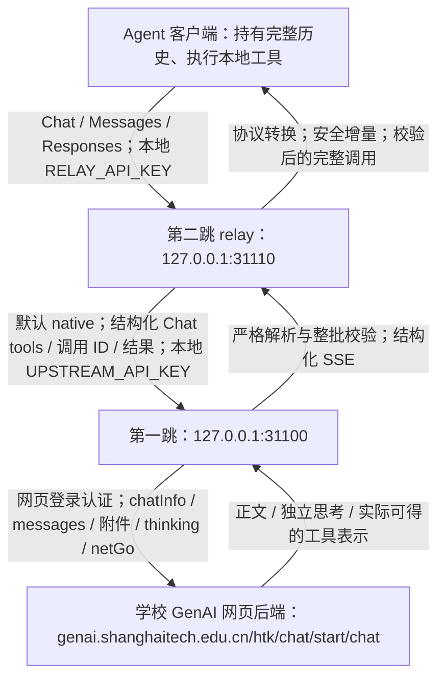
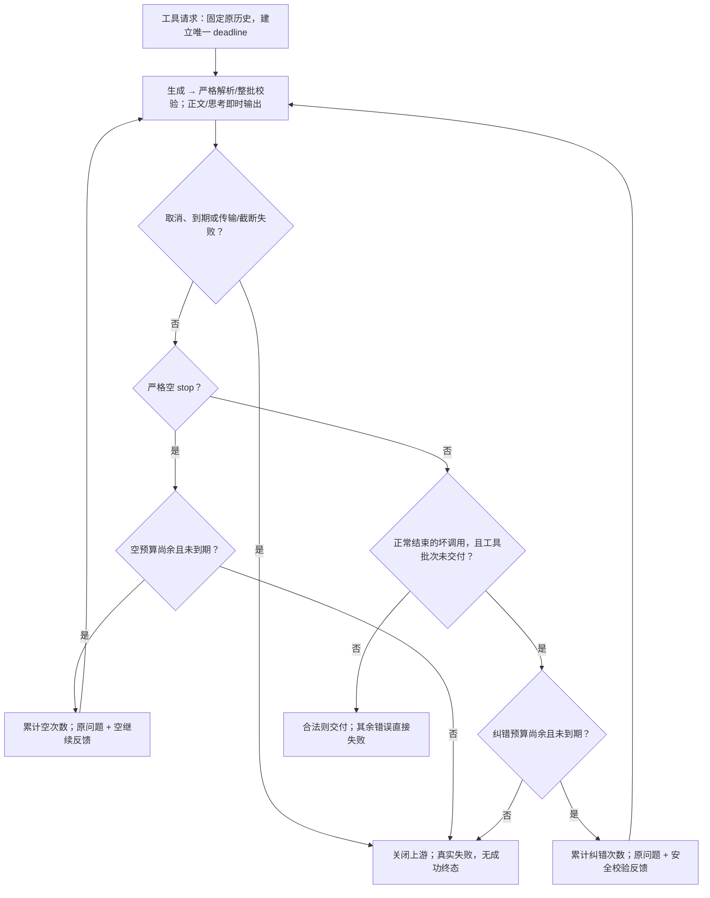

# 原生优先阶段说明：两跳链路与重构边界

本文记录 FrozenYears 两仓库 `main` 的两跳实现：第一跳空完成/未交付坏调用恢复，以及可选的 omp 自动验收监督。这些改造最初在 `feat/native-first-streaming` 开发。第五节使用冻结提交对照原作者与本地重构前版本；第七至十节保留历史部署和实测，第十一节记录主分支发布与服务停止状态。

## 1. 当前采用的路线



“第一跳/第二跳”沿用项目命名，不是按客户端请求经过的先后编号。第一跳自身也提供三种兼容 API，可以独立接客户端；**本阶段两跳路径中，relay 只通过第一跳的 Chat Completions 接口通信**。

因无法申请独立 API Key，本阶段明确放弃学校独立官方 API（`genaiapi.shanghaitech.edu.cn`）路线，不提供远程 base 示例、申请指南或绕过网页第一跳的直连方案。这一决策不删除本地 `UPSTREAM_BASE_URL`，也不把 `UPSTREAM_TOOL_MODE=native` 改为 `text`。

认证是三个不同边界：学校网页 JWT／账号认证由第一跳的 [`TokenManager`](../auth/token_manager.py) 管理；relay 的 `UPSTREAM_API_KEY` 应对应第一跳本地代理 Key；客户端使用 `RELAY_API_KEY` 访问 relay。后两者不是学校独立 API Key。未配置本地 Key 不等于具备安全隔离，服务应限制在受信网络。

## 2. 每层做什么、不做什么

### 客户端：持有工作状态并真正执行工具

客户端发送模型 ID、系统指令、完整历史、工具 Schema、选择/并行约束以及附件。收到完整且校验通过的 `tool_calls`、`tool_use` 或 `function_call` 后，由客户端按自身权限执行 Read/Write/Edit/Bash 等工具，再携带同一调用 ID 回传结果。两层代理都不会执行模型提出的命令，也不会因为参数里出现路径就读取本地工作文件。

代理没有可恢复的服务端会话存储；Responses 的 `previous_response_id`、`item_reference`、`store=true` 不能替代完整历史。调用格式正确只是传输条件，不是执行授权，也不证明写出的代码或文件内容正确。

### 第二跳：统一协议，尽量不丢结构

- **请求与历史**：三种入口转换为 `RelayRequest`。默认 native 保留 system/developer 角色、assistant 历史调用、原调用 ID、tool 结果及 `is_error`；Messages 的 `tool_use_id`、Responses 的 `call_id` 转成对应 Chat 关联字段，不按结果顺序猜归属。模型 ID 不由 relay 猜测映射。
- **工具**：普通函数保留名称、Schema 和可表达的 strict 标记。custom text 工具包装为参数 `{"input": string}` 的上游函数；Responses namespace 内部使用 `namespace.leaf`，返回时拆回 namespace/name。custom grammar 和不支持的托管工具不是静默降级，而是拒绝。
- **附件**：保留文本、图片、文档内容块及工具结果中的附件，转换外壳而不把 base64 展开成提示词正文；真正网页上传由第一跳完成。
- **思考**：将客户端可表达的 thinking/reasoning 设置映射为第一跳布尔开关；历史思考及元数据在 Chat 可表达的字段中保留。保留字段不等于网页会消费它们，更不等于跨供应商加密思考状态可以恢复。
- **搜索**：识别支持的 web_search 声明，转为第一跳搜索选项，而不是交付为客户端本地函数，也不伪造供应商托管搜索生命周期。
- **输出**：立即消费第一跳 SSE；正文与独立思考增量向下传递，工具参数等待终态后整批校验。适配为客户端要求的协议，不把第一跳已经解析的调用再次退化成文本再猜一次。

关键实现：[`prepare_chat`](https://github.com/FrozenYears/genai2agent-relay/blob/main/relay/normalize.py)、[`prepare_messages`](https://github.com/FrozenYears/genai2agent-relay/blob/main/relay/messages.py)、[`prepare_responses`](https://github.com/FrozenYears/genai2agent-relay/blob/main/relay/responses.py)、[`request_options`](https://github.com/FrozenYears/genai2agent-relay/blob/main/relay/features.py)、[`ActionRelay.stream` / `_prepare_messages`](https://github.com/FrozenYears/genai2agent-relay/blob/main/relay/engine.py)、[`UpstreamClient._payload` / `stream`](https://github.com/FrozenYears/genai2agent-relay/blob/main/relay/upstream.py)。

### 第一跳：适配网页协议，而不是冒充学校原生函数 API

1. Chat 入口先检查工具定义与约束，再用 `inject_tool_prompt` 将工具提示放在最新 user 轮附近。`normalize_tool_history` 把历史 assistant 调用写成带 ID 的 action 封套，把 tool 结果写成含 `call_id/output/is_error` 的已执行结果上下文；用户/结果中的控制标记作可逆转义，附件内容不因此改写。
2. `prepare_request` 处理附件与网页选项。最新 user 的文本成为 `chatInfo`，其余规范化消息成为 `messages`；请求模型名作为 `aiType`，元数据用于取得 `rootAiType`。不会凭空把网页端点变成接受标准 `tools` 的函数接口。
3. 当前轮图片以原 URL/data URL 放入 `imageUrls`；历史图片保留在该轮多模态消息。文档上传到网页业务接口：当前轮以同一请求会话的 `fileIds` 引用，历史文档以平台解析文本恢复上下文。每轮重新处理随请求携带的附件，没有附件缓存、`/v1/files` 或持久 `file_id` 存储。附件预处理发生在第一跳开始 SSE 之前，因此开始事件并不保证附件准备零等待。
4. 思考参数只控制布尔 `thinking`，不能实现不同 effort 档位或精确推理预算；独立 `reasoning`/`reasoning_content` 才映射为客户端思考字段，不凭正文语义猜测。搜索映射为 `netGo`，正文引用保留，额外查询的链接单独标为“补充检索结果（独立于正文引用编号）”；补充查询失败保留已有正文，不编造引用对应关系。
5. 网页返回结构化 `tool_calls` 时优先保留；否则从明确闭合的 Kimi XTML、DeepSeek DSML、XML 或 action 封套中严格提取。代码引用和 `<think>` 中的示例不是执行通道；不从裸 JSON 或函数样式文本猜调用，不修补引号、标签、参数名或类型。

关键实现：[`chat_completions`](../api/chat.py)、[`inject_tool_prompt` / `normalize_tool_history`](../tools/prompts.py)、[`prepare_request` / `search_sources`](../provider/features.py)、[`split_history_messages` / `_iter_genai_stream`](../provider/genai.py)、[`extract_tool_calls`](../tools/parsing.py)、[`parse_kimi_output`](../tools/kimi.py)。

## 3. native 与 text 的准确含义

| 项目 | 默认 `native` | 显式 `text` |
| --- | --- | --- |
| relay → 第一跳 | 标准 Chat 工具字段、结构化历史、流式调用字段 | 普通对话文本，工具定义/调用/结果编码为文本 |
| 系统与开发者指令 | relay 保留角色 | relay 转为普通上下文 |
| 工具历史 | 保留调用 ID、tool 角色与关联字段 | 封套保留 ID，结果按 ID 关联；附件仍保留 |
| 当前工具协议 | 由第一跳负责网页提示/解析 | relay 要求单个最终 `@@ACTION@@…@@END_ACTION@@` 封套 |
| relay 生成重试 | 不自动降级或重放模型生成 | 只有明确尝试了坏封套且尚未交付正文/思考时，才可按预算请求重写 |
| 适用范围 | 当前本地第一跳，两个仓库一起升级 | 明确只有文本能力的后端；不是 native 出错后的自动补救 |

这里有两种不同的“原生”：**relay 与第一跳之间的原生结构化传输**，以及**模型实际输出的结构化字段或 Kimi/DeepSeek 原生标记**。二者都不证明学校网页开放了原生函数输入。此前向网页直接附加 `tools/tool_choice` 的 DeepSeek、Kimi 短探针均未返回结构化工具字段；它们只是当时的负面样本，不是所有模型/场景的完备能力证明。

## 4. SSE 生命周期、终态与取消

### 正常完成

1. relay 在模型完成前发出协议开始事件：Chat 的 assistant role chunk；Messages 的 `message_start`；Responses 的 `response.created`、`response.in_progress`。第一跳自己的流式接口也先开始，再读取网页输出。
2. 第一跳 `heartbeat_events` 在等待期间以 10 秒间隔产生心跳，通过有界队列桥接读取线程。relay 转发上游心跳：Chat/Responses 使用 SSE 注释，Messages 使用 `ping`，没有另开定时心跳线程。心跳只说明流仍连通，不表示模型产生了有效答案，也不延长生成总时限。
3. 正文和独立思考即时交付；潜在工具标记跨chunk保留前缀，实际工具区域持续缓冲，完整校验后才交付工具事件。整代正文/思考暂存已回退。
4. 第一跳确认网页终态、严格解析并校验整批调用后才输出结构化工具事件。relay 的 `UpstreamClient.stream` 还要求第一跳同时有 `finish_reason` 与 `[DONE]`，调用索引连续、调用终态一致；`ActionRelay` 再检查完整批次。
5. 校验通过后，relay 发出完整工具事件，再成功结束：Chat 的 finish chunk + `[DONE]`；Messages 的完整块及 `message_delta`/`message_stop`；Responses 的 item/arguments done 与 `response.completed`。Responses 的 `sequence_number` 单调递增，生命周期内 ID 稳定。协议可能使用名为 delta 的参数事件，但其中工具参数已经整体校验，不是允许执行的半成品。

### 校验、错误与截断

- 入口拒绝不合法请求；输出同时检查工具白名单、JSON Schema、重复 JSON 键、非有限数、重复 ID、`none/required/指定工具` 与禁止并行约束。任意坏成员使整批失败，不删除坏成员再交付其他调用。Schema 引用仅限本地，不为校验访问外部网络。
- 明确坏封套、多封套、缺标签、提前 EOF、工具参数截断均不能变成成功调用。已经交付的正文无法撤回，但工具不会因此提前执行。
- 已发送响应头后，错误通过 SSE error 传播，不再发送成功终态；relay Responses 还发送 `response.failed`。非流式上游/传输失败返回 502，入口参数错误返回 400。
- 第一跳按本地估算 token 强制输出预算，包含思考；普通文本截断分别为 Chat `length`、Messages `max_tokens`、Responses `response.incomplete`，工具截断报错。**经过 relay 时，当前引擎只接受 `stop/tool_calls` 成功终态；第一跳的 `length` 会变成 relay 错误，不应把直连第一跳的截断行为套用到两跳链路。**
- relay 的 `MAX_ACTION_BYTES` 限制解码后正文、思考和工具有效载荷，也约束单个未闭合 SSE 事件；重复帧元数据/心跳不占工具参数预算。Schema/strict 标记和交付前校验不是生成端 constrained decoding。

### 取消与重试边界

关闭消费流会沿生成器 `finally` 关闭上游响应；第一跳 `StreamControl` 设置取消标志并关闭已取得的实际 HTTP 响应/socket，避免后台继续读取。取消或总时限到期时都执行该清理。尚未收到响应头的 `requests` 阻塞连接不能立即打断：主响应仍按总时限返回失败，worker 待请求返回后关闭资源，不再发起后续继续。不能承诺立即终止学校远端推理，也不能回滚客户端已执行的工具。

**默认 native 链路只在第一跳恢复生成，relay 不叠加预算。** 每代先通过同一个 `validated_events` 完成解析和整批校验，恢复状态机再决定交付、反馈或失败；三种 API、流式和非流式共用这一入口。

两类预算独立累计：

- **空完成继续**：工具请求零原始正文、零思考、零调用，且正常 `stop`；默认额外 `E=8`，范围 `0..30`。
- **工具协议纠错**：正常终态的工具协议/JSON/Schema/选择错误，且工具批次尚未交付时，默认额外`R=3`，范围`0..10`。已显示的正文/思考保留，不阻止对未交付工具的纠错；不撤回、隐藏或程序化重放原进度，也不保证模型不会重复说明。

首次及所有恢复最多 `1+E+R` 次生成，默认 12 次，**不是每一轮都重新获得两类预算**。共用从首次上游生成开始的 **900 秒**窗口，不含附件预处理；ping、心跳、纠错和空继续均不续期。0 只关闭相应恢复类别，不关闭工具请求总时限。无工具请求不启用这些恢复或工具 deadline。

每次恢复使用原问题加真实类别/次数/安全诊断，完整原历史和工具约束不变，不积累空 assistant、旧继续提示或虚构 tool 结果。不把坏批次放行一部分，也不执行或重放客户端操作。JSON 诊断不拼接任意异常文本或模型参数；Schema 反馈只包含约束和声明的缺失字段。上游原生片段错误先记录，在正常终态后统一拒绝；断流和 `length` 不能借此伪装为可恢复的模型错误。

网络/上游错误、提前EOF、截断、取消或到期均不走工具协议纠错，已交付工具绝不重放。正文/思考即时显示，失败尝试的进度也可能可见。`auto`下普通非空计划正常结束；`required/指定工具`未返回调用属于可纠错的选择错误。空耗尽为`upstream_empty_response`，工具耗尽保留原错误码，到期为`upstream_request_timeout`，均不发送成功终态。



显式 text 模式仍只对尚未交付正文/思考的明确坏封套作有限纠错，不重试空回答、断流、截断、普通示例或工具执行；它不是 native 出错后的兜底。HTTP 401 的网页登录刷新是独立认证恢复，元数据/附件阶段的令牌恢复仍有已知缺口。

### 恢复与时限配置

下列设置属于**第一跳**；在根项目 `.env` 或启动参数中配置，不放进 relay 的 `.env`。

| 第一跳环境变量 | CLI 参数 | 默认值 | 含义 |
| --- | --- | --- | --- |
| `GENAI_EMPTY_CONTINUATIONS` | `--empty-continuations` | `8` | 空完成额外次数，整数 `0..30`；0 禁用 |
| `GENAI_TOOL_REPAIR_ATTEMPTS` | `--tool-repair-attempts` | `3` | 未交付坏批次额外纠错，整数 `0..10`；0 禁用 |
| `GENAI_TOOL_REQUEST_TIMEOUT_SECONDS` | `--tool-request-timeout` | `900` | 首次与所有恢复共用秒数，有限正数 |

`Config.__post_init__` 拒绝越界/非整数次数、非有限或非正时限，均拒绝布尔值；在网页登录前校验。CLI 覆盖环境变量：

```bash
pixi run serve --empty-continuations 8 --tool-repair-attempts 3 --tool-request-timeout 900
```

不要混淆网络 connect/read timeout（第一跳 10/300 秒、relay 默认 10/1800 秒）、单请求 900 秒累计生成窗口，以及 agent 整场任务预算。网络 ping 不延长总生成窗口。

### Agent 自动验收与停滞恢复

[`supervisor.py`](../validation/native-first-endurance/supervisor.py) 接收真实 agent 客户端、任务和独立验收回调；[`supervise.py`](../validation/native-first-endurance/supervise.py) 提供通用 CLI，原 20 阶段 runner 也使用相同监督循环。默认额外 8 次自动反馈、整场 45 分钟、单轮 1200 秒；工具请求 900 秒窗口只约束其中某次 HTTP。

模型正常 stop 不等于任务通过。监督器运行真实验收，把失败、工具/协议错误和未完成状态作为新反馈提交给同一会话。连续无工具或相同验收差异触发明确停滞反馈；预算尚余时不因为重复失败就等待人工。反馈要求先核对磁盘和已执行状态再增量修复，不直接重放调用；之前报告的“显式反馈”也本来由测试脚本自动提交，不是人逐轮输入。

单请求预算耗尽可自动进入新 agent 回合，但任务预算不会重置。反馈耗尽为 `feedback_budget_exhausted`，总时间耗尽为 `wall_time_limit`；保存实际会话、工作目录、逐轮验收、`result.json` 和 `checkpoint.json` 并非零退出。当前不实现跨进程自动恢复。身份切换/权限拒绝/客户端退出、控制器或验收器不可用也明确失败，不靠增加预算掩盖。prompt 超时先 abort，必须证明本轮结束且 RPC 状态 settled 才能再次提交；最多另等 30 秒用于安全停稳，无法确认则 `session_not_settled` 停止。

通用 CLI 的任务文件与验收 argv 来自操作者。验收本地 `shell=False` 执行，限制时间、输出与环境凭据；默认不给模型 bash，只有显式授权模式才开放。验收和审计文件应在模型工作目录外；这些措施不是 OS 文件沙箱。任意任务没有可靠验收器时，监督器也不能证明业务成功。

关键实现：第一跳 [`heartbeat_events` / `StreamControl` / `validated_events`](../provider/streaming.py)、[`validate_tool_request` / `validate_tool_calls`](../tools/contracts.py)；relay [`validate_native_calls` / `decode_action` / `validate_choice`](https://github.com/FrozenYears/genai2agent-relay/blob/main/relay/actions.py)、[`UpstreamClient.stream`](https://github.com/FrozenYears/genai2agent-relay/blob/main/relay/upstream.py)、[`chat_events` / `message_events` / `response_events`](https://github.com/FrozenYears/genai2agent-relay/blob/main/relay/streaming.py)。
实现前通过 GitHub 字面源码检索并直接核对 [Pydantic AI 的 SQL 验收示例](https://github.com/pydantic/pydantic-ai/blob/main/examples/pydantic_ai_examples/sql_gen.py)：真实 `EXPLAIN` 校验失败后使用 `ModelRetry` 将诊断交回模型，而不是修字符串后直接执行。本项目只借鉴“独立校验→有限反馈→重新生成”，没有引入该依赖或复制其实现；它不证明学校网页具备生成端约束，也不保证业务成功。


## 5. 与双跳原仓库及本地重构前分支的对照

### 5.1 对照版本与范围

以下以2026-10-25核对的远端分支及本地Git快照为准。分支会移动，表中链接固定到提交；“原仓库”指两位原作者的仓库，而不是当前个人fork或本地同名分支。

| 基线 | 第一跳 `shanghaitech-genai2api` | 第二跳 `genai2agent-relay` |
| --- | --- | --- |
| 原作者 `main` | [`jollyxenon`：`7e95aab`](https://github.com/jollyxenon/shanghaitech-genai2api/tree/7e95aab9cb2e76d9f1a7686e4c0ed3dbabf9525e) | [`negativegluon`：`dbb8f65`](https://github.com/negativegluon/genai2agent-relay/tree/dbb8f65841345704b84c5dd368190277dcdd5737) |
| 首次对照时的个人fork `main` | [`FrozenYears`：`7e95aab`](https://github.com/FrozenYears/shanghaitech-genai2api/tree/7e95aab9cb2e76d9f1a7686e4c0ed3dbabf9525e)，当时与原作者相同 | [`FrozenYears`：`6b02115`](https://github.com/FrozenYears/genai2agent-relay/tree/6b02115ea3bdaba6e803223fd3e5af46d73104ba)，当时已包含部分文本链路修复 |
| 本地原生重构前 | [`e682010`](https://github.com/FrozenYears/shanghaitech-genai2api/tree/e682010d1acff9e0ee194d2685e73490e2369ecc)，即 `a7b3186^`；承接本地Windows线 `960ce71` | [`5d3bd12`](https://github.com/FrozenYears/genai2agent-relay/tree/5d3bd12855269e9b6e901dc87465f5ca11f96157)，即 `44639ec^`；与本地 `main@5ad2e8e` 内容树相同 |
| 开发阶段的功能快照 | [`bc99766`](https://github.com/FrozenYears/shanghaitech-genai2api/tree/bc99766401b70b164ab7176f10763c5214c6fc46)，当时发表于 `feat/native-first-streaming` | [`4a137bc`](https://github.com/FrozenYears/genai2agent-relay/tree/4a137bca3b8fcf39594db83b3c016eddb73b9797)，当时发表于 `feat/native-first-streaming` |

当前安装与文档入口是 FrozenYears 两仓库的 `main`。表内历史分支名不能代替冻结提交；下列是源码与设计对照，不是同一上游负载下的性能或成功率排名。

### 5.2 总体设计为什么改变

原第二跳面向“不可靠支持原生工具的普通Chat后端”：主动去掉工具/系统角色通道，把定义、历史和结果转成普通文本，等待完整action封套，再校验并恢复为客户端工具事件。这个取舍将工具格式适配集中到第二跳，代价是上游结构丢失和整份响应缓冲；它不是没有安全校验或没有三协议接口。

当前第一跳和第二跳一起维护，第一跳本身已有工具适配能力。因此改为**两跳之间保留标准工具结构，只有第一跳承担学校网页的文本边界**。第二跳消费结构化SSE，不再把已恢复的调用转成文本后重复推断；客户端仍执行工具。请求级恢复集中第一跳，业务验收和任务续作则交给可选agent监督器，三者职责不互相冒充。

### 5.3 第一跳：保留网页能力，重做工具契约与交付

| 维度 | 原作者 `main@7e95aab` | 当前实现 |
| --- | --- | --- |
| 协议入口 | 已有Chat、Messages、Responses；不是只有Chat | 保留三入口，统一请求校验和模型输出交付契约；不是本次才加入Responses |
| 上游与认证 | 学校网页聊天端点；已有JWT、学号密码/CAS登录和令牌刷新 | 仍走相同网页路线，不转独立官方API；登录恢复不等于所有元数据/附件认证缺口都已修复 |
| 文本工具解析 | 已有XML/DSML；还会尝试宽松JSON、Python字面量、裸JSON、函数样式、代码围栏和畸形参数恢复，部分路径补括号/转义或猜Bash参数 | 只接受明确完整的action/XML/DSML/Kimi协议；删除宽松猜测和参数修补，引用内示例不当作执行通道 |
| 网页结构化输出 | 通用流主要读取正文和思考，不累计标准 `delta.tool_calls` | 按index累积调用ID、名称和参数；原生字段优先，完整终态后再统一校验；不保证学校每次会输出这些字段 |
| 参数与批次校验 | 工具名过滤不等于完整Schema契约；部分解析路径跳过坏/未知调用继续提取 | 三协议共用JSON Schema、choice、并行限制和唯一ID校验；重复键/非有限数拒绝，一个坏成员拒绝整批 |
| 历史关联 | 历史调用转文本时存在丢失调用ID的路径，工具结果虽含ID也不足以完整配对 | 历史assistant调用ID与tool结果ID关联保留，结果明确为已经执行，不按顺序猜归属 |
| 流式与资源 | 第一跳原本已能流出普通正文/思考；工具也原本需等收全，不应写成“原版完全不流式” | 开始、正文、思考与心跳即时输出；工具批次完整校验后交付，不承诺逐token工具执行 |
| 网页特性与部署 | 已有图片、文档、搜索、思考开关及Pixi使用方式 | 继续保留；思考仍只是布尔开关、搜索是网页功能、文档仍走网页上传，不把这些列为native重构新增的模型能力 |
| 生成恢复 | 没有当前统一的空继续/未交付坏调用恢复状态机和累计生成deadline | 严格空完成额外8次、未交付坏工具批次纠错3次，共享900秒；已显示进度保留，已交付工具及断流/截断/到期不重放 |

源码依据：原版 [`provider/genai.py`](https://github.com/jollyxenon/shanghaitech-genai2api/blob/7e95aab9cb2e76d9f1a7686e4c0ed3dbabf9525e/provider/genai.py)、[`tools/parsing.py`](https://github.com/jollyxenon/shanghaitech-genai2api/blob/7e95aab9cb2e76d9f1a7686e4c0ed3dbabf9525e/tools/parsing.py)、[`provider/features.py`](https://github.com/jollyxenon/shanghaitech-genai2api/blob/7e95aab9cb2e76d9f1a7686e4c0ed3dbabf9525e/provider/features.py)；当前 [`iter_genai_stream` / `_iter_genai_stream`](https://github.com/FrozenYears/shanghaitech-genai2api/blob/bc99766401b70b164ab7176f10763c5214c6fc46/provider/genai.py)、[`validated_events`](https://github.com/FrozenYears/shanghaitech-genai2api/blob/bc99766401b70b164ab7176f10763c5214c6fc46/provider/streaming.py)、[`validate_tool_calls`](https://github.com/FrozenYears/shanghaitech-genai2api/blob/bc99766401b70b164ab7176f10763c5214c6fc46/tools/contracts.py)。

### 5.4 第二跳：从纯文本工具中继变为native-first流式网关

| 维度 | 原作者 `main@dbb8f65` | 当前实现 |
| --- | --- | --- |
| API外壳 | 已有Chat、Messages、Responses、模型列表及token粗估端点 | 接口继续保留；主要变化是内部传输、校验与响应生命周期，不是新增加三协议 |
| 上游契约 | `TextActionRelay` → `backend.complete()`；固定 `stream:false`，上游返回原生 `tool_calls` 会被明确拒绝 | `ActionRelay.stream()` → `backend.stream()`；默认native发送结构化tools/choice/parallel并接收原生调用，非流式客户端也消费同一内部流 |
| 角色与工具定义 | 去掉原生工具/系统角色通道，system/instructions合入普通上下文，工具Schema写进文本 | native保留可表达的system/developer角色、工具Schema和strict字段；第一跳再完成网页适配 |
| SSE体验 | 接受 `stream:true`，但上游整份完成并校验后才生成下游SSE | 开始事件先发并转发心跳；内容按第一跳的校验时机转发，工具整批交付，Responses事件序号和生命周期稳定 |
| 历史与调用ID | 历史主要转为文本封套，不能以三个API外壳存在推断调用ID全链路保留 | native保留调用ID、结果ID、错误标志和可表达的思考元数据；显式text也保留历史关联 |
| 原有安全检查 | 已有白名单、JSON Schema、大小限制及校验后交付，不应描述为原版“没有校验” | 在原有边界上强化严格JSON、重复键/非有限数、多封套、ID、choice/并行限制和完整终态；错误不靠选取最后一个可解析封套掩盖 |
| 工具表达范围 | 普通function为主要适配路径；内部custom类型不等于各入口完整支持custom/namespace | 支持custom text包装和Responses namespace；custom grammar及未实现的托管工具明确拒绝，不宣称供应商全兼容 |
| 重试归属 | 文本封套纠错在第二跳，原作者默认额外1次；不是第一跳当前的两类预算 | native第二跳不重试生成，由第一跳处理8/3/900；显式text才使用第二跳序列化预算（当前默认额外2次），不自动降级 |
| 错误与资源预算 | 上游主要报告HTTP状态/坏JSON，非流式读取整份响应；大小约束主要检查完整文本 | 安全保留第一跳message/type/code并限长脱敏；消费时限制正文、思考、调用和未闭合SSE事件；缺终态/断流明确失败，不发成功结束 |
| 附件、思考和搜索 | 已透传图片/文件，映射思考开关与网页搜索，不能列为当前首次支持 | 延续透传与功能映射；真正附件处理仍在第一跳，不新增本地工具执行权 |
| Responses状态 | 没有实现可恢复服务端response存储；接收或忽略字段不能证明功能存在 | 明确拒绝previous_response_id、item_reference、store=true等；仍要求完整历史，不把“不支持”包装为成功 |

源码依据：原版 [`README`](https://github.com/negativegluon/genai2agent-relay/blob/dbb8f65841345704b84c5dd368190277dcdd5737/README.md)明确说明buffered SSE；[`UpstreamClient.complete`](https://github.com/negativegluon/genai2agent-relay/blob/dbb8f65841345704b84c5dd368190277dcdd5737/relay/upstream.py)固定非流式且拒绝原生调用。当前对应 [`ActionRelay`](https://github.com/FrozenYears/genai2agent-relay/blob/4a137bca3b8fcf39594db83b3c016eddb73b9797/relay/engine.py)、[`UpstreamClient.stream`](https://github.com/FrozenYears/genai2agent-relay/blob/4a137bca3b8fcf39594db83b3c016eddb73b9797/relay/upstream.py)、[`relay/streaming.py`](https://github.com/FrozenYears/genai2agent-relay/blob/4a137bca3b8fcf39594db83b3c016eddb73b9797/relay/streaming.py)及[`relay/actions.py`](https://github.com/FrozenYears/genai2agent-relay/blob/4a137bca3b8fcf39594db83b3c016eddb73b9797/relay/actions.py)。

### 5.5 本地重构前已经做过什么

这部分属于原作者版之后、native重构之前的先行改进，不应再次当成当前新增：

- 第一跳本地Windows线已完善action封套、引用/控制标记处理、工具结果提示及Kimi K3 XTML解析，旧实现仍保留多个宽松fallback。Windows启动与缓存隔离属于本地部署工作；Pixi本身原作者已使用。
- 第二跳个人fork `main@6b02115` 已提高文本重试预算并补充JSON位置/Schema诊断、截断拒绝及空回复继续。本地重构前又包含引用/标记保护和工具结果提示等修复，但核心仍为 `TextActionRelay.run → backend.complete()` 文本路径，不是native-first。
- 当前分支随后先迁移结构化传输/流式和严格整批交付，再补安全错误传播、累计deadline、空继续/工具纠错，最后提取通用agent监督器。监督器是额外工作流，不是原作者relay内置的任务执行器；旧长期验收脚本也曾自动提交显式反馈，不能说此前全靠人工逐轮诊断。

本地冻结源码可分别查阅第一跳 [`e682010/tools/parsing.py`](https://github.com/FrozenYears/shanghaitech-genai2api/blob/e682010d1acff9e0ee194d2685e73490e2369ecc/tools/parsing.py)、第二跳fork [`6b02115/relay/engine.py`](https://github.com/FrozenYears/genai2agent-relay/blob/6b02115ea3bdaba6e803223fd3e5af46d73104ba/relay/engine.py)与重构前 [`5d3bd12/relay/engine.py`](https://github.com/FrozenYears/genai2agent-relay/blob/5d3bd12855269e9b6e901dc87465f5ca11f96157/relay/engine.py)；当前监督入口为 [`supervise.py`](../validation/native-first-endurance/supervise.py)。

### 5.6 迁移收益、代价与没有改变的边界

- **收益**：减少两跳间有损文本转换，保留角色/调用关联，即时发送开始与心跳；错误可归因，未交付的模型协议错误可有界恢复；任务是否完成由独立验收判断。
- **兼容代价**：裸JSON、Python字面量或畸形参数被拒绝或要求模型重新生成。工具批次需等待完整校验；正文和思考不做整代缓冲，已显示内容不能撤回。服务端状态、grammar等不支持的功能明确拒绝；恢复会增加请求数和耗时。
- **升级要求**：默认native需要两个仓库一起升级。旧纯文本backend若继续使用，必须显式选择text；没有保留旧 `TextActionRelay`/`complete()` 扩展接口的自动兼容层，自定义backend需迁移到stream接口。
- **没有改变**：只有客户端执行本地工具；两个代理没有文件操作授权或OS沙箱，也没有服务端任务会话存储。学校网页仍是最终上游，原生输出解析和两跳结构化传输均不能证明网页开放了标准函数输入。
- **验证边界**：本次新增的是冻结源码对照文档，不重启服务、不重跑模型。第十节的既有长测说明当前特定任务可以自动恢复完成，不能证明比原作者版普遍更快/更准，也不是官方API等价测试。


## 6. 不能承诺的边界与证据口径

- 学校网页模型可用性、配额、缓存、速度和稳定性由平台决定。首事件较快只代表协议已开始，不代表模型首字或工具参数已完成；长参数仍需等待完整生成。
- 不保证所有客户端工具、附件格式、模型组合均兼容。custom grammar、服务端 Responses 状态及未实现的托管工具明确不支持。客户端能发送文档块，不等于模型会主动选择正确上传流程。
- 思考可能不返回，或以未标记正文出现；不补造思考。Messages 的 `genai-compat-no-signature` 只是兼容占位，不是真实 Anthropic 签名；Responses 不重建加密 reasoning 状态。
- 用量为本地文本估算，不是供应商真实计费量，也不包含准确视觉 token。精确采样、推理档位与预算不能因接收了某字段就宣称网页支持。
- 严格 Schema 只能证明结构符合声明，不能证明命令安全、复制内容正确或任务完成。重要写入仍须客户端实际运行、独立回读/哈希核验，长文件优先局部编辑。
- 本文前六节是当前源码与协议边界记录；第七至九节是此前部署和长测历史。旧版结果不自动证明当前版本稳定；本轮源码、真实 HTTP 故障注入与自然模型工作结果必须分别记录。

### “接近官方 API”的适用范围

可采用的结论是：**在已验证的本地编码、文件操作和数据库任务中，配合独立验收监督器，当前链路已表现出接近标准 API 驱动 agent 的连续工作体验。** 依据是第十节保留的真实工具执行、独立验收及自动恢复记录，不是模型自报完成。

不能据此宣称“大部分场景均达到官方 API 同等级可靠性”：没有官方 API 对照测试，样本也不覆盖任意业务、模型负载和所有客户端。接近的是已测场景的接入与续作体验，不是网页上游原生函数输入、生成端 Schema 约束、延迟/SLA、完整供应商状态或全部 API 能力。

此结论还依赖工作流配置：第一跳负责请求级恢复，**可选监督器**才负责验收失败、计划停滞和已交付内容后的新回合续作；未启用它的普通客户端不会自动获得同样的任务级恢复。任何层的预算或安全边界耗尽都可明确失败，不承诺无限成功。

## 7. 历史正式部署与长时工作结论（预算升级前）

以下为此前重构版本在正式 31100/31110 的验收记录，不是本次多次空继续/共享时限版本的部署证明。当时第一跳沿用 0.0.0.0 监听，relay 为 loopback；不将历史进程 ID 当作当前服务身份。

主客户端使用用户已配置的 omp 18.12.6，RPC 状态确认两模型都走 `GenAI` provider 的 `http://127.0.0.1:31110/v1`，不是官方 API。两个模型分别保持连续历史，运行同一套 20 阶段实际财务流水项目，使用真实文件/进程/SQLite 和独立累计验收。

Kimi 在约 31 分 44 秒完成全部阶段，但有两次流错误，需要显式继续；DeepSeek 运行约 8 分钟、完成前 9 阶段后，在第 10 阶段因空回复和流错误未能恢复。当前实现不能概括为“长时无故障”，更不能把端口健康或解析器通过等同于 agent 稳定完成任务。详细指标、失败和复现方法见 [正式 omp 验收报告](TEST_REPORT_deepseek_pro.md#2026-10-25正式双跳重启后的-omp-持续开发验收)，机器可读证据见 [验证摘要](../validation/omp-endurance-2026-10-25.json)。


## 8. 历史持续工作故障的根因与一次继续修复

### 已证实与未证实

| 层次 | 已取得的证据 | 判断 |
| --- | --- | --- |
| 学校网页输出 | 真实 omp 失败续作的原始 SSE 只有空 assistant 起始帧和正常 stop；另一例期间有 ping，但仍无正文、思考或调用 | 这一类空回复发生在网页上游，不是 relay 丢掉了完整答案 |
| 第一跳终态 | 旧逻辑把上述空 stop 当成正常完成；第二跳最后才报 no answer | 第一跳缺少逻辑回答完整性边界，直接客户端可能误以为完成；现已统一识别空完成 |
| 两跳错误传输 | 第一跳 Schema/解析/断流错误被 relay 替换成统一 stream error，非200错误体也丢原因 | 确定的代理缺陷：错误类别丢失使客户端无法针对性恢复，也使原报告的 Kimi 两次错误无法事后精确归因 |
| 工具执行 | 金额验收失败、edit 匹配两处由执行器真实报告，随后修正 | 属于模型生成代码或编辑上下文问题，不应让代理猜参数、压掉错误或伪造成功 |
| 历史与 parser | 审阅保留的 ID、结果关联及当前 user 拆分，未发现本轮失败由这些路径导致的证据 | 不作无依据的角色重写，不从引用或不闭合原生标签中猜执行 |

网页内部为何偶发空 stop，当前权限和日志不足以定位到推理 worker、缓存、排队或解码实现。对同一保留请求分别测试原样、增加会话 ID、降低预算、关闭思考：原样也能再次有正文，关闭思考仍出现空 stop，延迟波动明显；单次变体不能证明因果。没有据此加入随机会话 ID、强制串行、偷偷减小输出预算或关闭思考。

真实 OMP 会在工具 Schema 中增加意图字段 `i`。取证初期仅从 `dumpTools` 重构请求会漏掉它，导致虚假的 Schema 失败；该批不作为原始故障根因证据，后续改为记录真实 OMP HTTP 请求与网页 SSE。不能拿不忠实的重放结果证明模型或代理错误。

### 修复边界

本节保留首次根因修复时的行为与证据；下述“一次”仅指该历史版本。当前可配置的额外继续次数及共享生成窗口以第四节为准。

1. 当时第一跳 [`iter_genai_stream`](../provider/genai.py) 对工具请求只处理**完全空、正常 stop**这一已复现形态：不交付空终态，保留完整历史，追加一次明确继续指令。没有新的客户端调用被交付，所以不会重放已执行工具；该历史版本最多一次，持续为空仍以 `upstream_empty_response` 失败。它是对平台空输出的有界恢复，不是修复了学校推理服务内部故障。
2. [`validated_events`](../provider/streaming.py) 不再把空/仅思考的回答当成功；有思考增量、可见文本、坏参数、网络错误或长度截断时禁止该自动继续。完整批次、Schema 与权限边界不放宽。
3. [`ToolContractError`](../tools/contracts.py) 与三个输出适配器保留明确错误代码。参数错误报告工具、约束、字段及路径，不携带文件正文、命令或其他参数值。
4. relay 的 [`UpstreamError`](https://github.com/FrozenYears/genai2agent-relay/blob/main/relay/errors.py) 仅透传安全的结构化 `message/type/code`，限长并脱敏；坏 JSON、过大错误体不回显，失败后不发送成功终态。没有新增模型兜底或工具执行重试。

该历史版本的回归覆盖零输出后一次恢复、持续为空、思考后禁止重放、Schema/解析/网络错误分类、断流后无成功终态、取消关闭与凭据保护。当时记录第一跳 305 项、relay 89 项及 259 个子测试通过，**不是本次预算升级的测试结果**。实际续作及故障注入的不同证据口径见 [根因修复验收报告](TEST_REPORT_deepseek_pro.md)；不能将故障注入计成自然长测成功。

当时正式 31100/31110 重启后，两模型均通过真实 omp write/read 闭环；这只证明历史一次继续修复的短闭环，不替代当前预算版本的长时复测。链路始终只连接学校网页，未启用独立官方 API。


## 9. 历史多次空继续版本的部署与实际复测

以下为升级到双类别恢复与通用监督器之前的记录，不是当前进程身份。该轮正式服务在原端口重启，第一跳 Python PID62956，启动参数 `--empty-continuations 3 --tool-request-timeout 600`；relay Python PID107928，native 且只连本地31100。启动日志确认3次/600秒，健康检查正常，没有使用独立官方 API。

第一跳388项回归通过，relay89项及259个子测试通过。真实socket测试中，上游持续只发ping；0.2秒生成窗口仍在约0.234秒返回 `upstream_request_timeout`，关闭连接并退出读取线程，没有交付工具或发第二次请求。这验证的是deadline，不是模型成功率。

使用用户现有GenAI配置的真实omp，在两个全新隔离目录、各自连续历史中尝试同一套20阶段实际开发。DeepSeek本轮用851.204秒完成20阶段、执行165次工具，最终71项累计验收通过。正式源日志显示17个逻辑请求触发共20次空继续，3个请求用到第2次继续，直接说明旧的一次预算不足以覆盖这些连续空完成；本轮未自然触发第3次，最大次数边界由回归验证。另有两次edit缺path，仍须显式反馈修正，不按空回复重放。

Kimi本轮330.282秒后停在第1阶段：初次及两次显式反馈都以正常非空答复结束，但前两轮只给计划，最后虽写代码并运行程序，金额舍入仍有一项独立验收失败。没有空继续、次数耗尽或deadline错误。不能因为代理交付正常stop就把任务算作完成，更不能用加大空预算来重试非空计划或“修正”业务代码。

因此该版预算可以提高连续空完成的恢复机会，但仍不保证整个任务永不中断。该次两轮“显式反馈”由测试脚本自动提交，不是人逐次输入。详细数据及限制见[历史复测报告](TEST_REPORT_deepseek_pro.md#2026-10-25历史多次空继续预算部署与正式双跳复测)和[机器可读摘要](../validation/recovery-budget-2026-10-25.json)；不能把不同随机运行当作受控A/B或模型能力排名。


## 10. 当前双类别恢复与监督器的正式验证

本节保留当时部署和验收记录，不代表服务仍在运行。反代已按用户要求停止，见第十一节；不改写当时的成功、失败和测试结果。

正式服务已重启：第一跳 Python PID107568（31100），服务 `GenaiFirstHopAutoRecovery`，显式参数 `--empty-continuations 8 --tool-repair-attempts 3 --tool-request-timeout 900`；relay Python PID104472（31110），服务 `GenaiRelayAutoRecovery`，native 且仅连接本地第一跳。启动日志确认8/3/900，两个 `/health` 正常，均保持 persistent；仍只用学校网页认证和网页聊天端点。

回归为根562项、relay89项及259个子测试通过。真实HTTP socket故障注入覆盖第一跳与完整双跳、三协议流/非流共12条恢复路径：空完成→缺参→坏JSON→合法调用，最终每条只交付一个合法调用；另证实原生参数坏JSON可纠错，正文/思考已交付或截断不重放，纠错耗尽保留原错误码。持续ping在0.2秒窗口下约0.235秒触发deadline。首版临时冒烟脚本把Responses合法的`error:null`误当故障，修正为解析事件类型/非空error后通过；这不是服务修复或模型成功率数据。

通用CLI经真实omp的`GenAI/Kimi-k3`（`openai-completions`、`http://127.0.0.1:31110/v1`）完成独立库存程序，5种文件工具、不提供bash。模型实际执行4次工具，其中一次读取不存在文件，随后真实写入及回读；独立进程8个业务用例通过，agent轮次约65.063秒，未触发监督反馈。模型未运行程序不等于只看自报结果：程序由监督器固定验收命令实际执行。

同一20阶段账本长期验收仍使用固定workload、全新工作目录和连续真实omp历史，默认8次自动反馈、45分钟整场预算、单轮1200秒。无人工逐次诊断或输入，不换模型，不打开客户端隐藏请求重试/扩展/MCP；“无监督反馈通过”不等于没有第一跳恢复或工具失败。

DeepSeek本轮595.000秒完成20/20阶段，150次工具、104次客户端模型响应，最终71项累计验收通过，20阶段均无需额外agent反馈。第一跳自然日志记录8次空继续、4次工具纠错（3个请求，其中一个用到第2次纠错，且与空继续发生在同一请求），均在原请求内恢复，没有暴露协议失败。4次实际工具错误包括2次未获授权bash被策略拒绝、一次生成代码语法错和一次旧数据库迁移失败；模型未获扩大权限，后续使用获准操作并修复，同轮最终验收通过，失败完整保留审计。

Kimi本轮1825.531秒完成20/20阶段，110次工具、94次客户端模型响应，最终71项累计验收通过；17阶段无需额外agent反馈，另外3阶段共4次自动反馈：

- 第2阶段：坏action JSON中断，汇总模块虽已写入，入口未接线。监督器交回真实`unknown_operation`验收差异，模型回读、接线并通过。
- 第3阶段：未知/不允许的工具调用被拒绝，当时业务验收已通过但agent回合仍是error。自动续作使用获准的真实验收命令，正常结束。
- 第4阶段：两轮正常stop仅给SQLite实现计划，第二轮零工具、相同验收仍失败。监督器自动检测停滞、再次反馈，模型随后实际写入持久化模块、接线并通过；没有等人输入。

第2/3阶段错误响应已有独立思考和正文（第2阶段正文只有点号也仍算已交付），不能在同一流中撤回重放，因此由agent监督层发新回合，而不是放宽第一跳。Kimi本轮没有第一跳空继续或工具纠错；第20阶段一次edit匹配失败在同轮恢复。上一轮金额失败本次第1阶段已通过，不证明模型生成错误被永久消除，更不能倒推此前是反代损坏。

本轮自然样本最多用到第1次空继续、第2次工具纠错、单阶段第2次监督反馈，没有自然证明需要用满8次预算。两次运行不是受控旧新A/B，不据此承诺任意任务或所有客户端永不中断。当前“停滞标记”是验收签名/工具数启发式：Kimi记录2个标记，其中第3阶段成功续作因验收结果重复也被标记；实际带停滞指令的反馈只发生在第4阶段，不将两个标记都描述成恢复事故。

详细参数、结果、固定fixture哈希及日志计数见[本轮机器摘要](../validation/automatic-recovery-2026-10-25.json)和[正式测试报告](TEST_REPORT_deepseek_pro.md#2026-10-25未交付工具纠错与自动监督正式长测)。两模型原始会话、代码和SQLite及通用CLI证据按用户选择保留；仅删除本轮受控HTTP故障注入临时脚本，旧证据不动。


## 11. main 发布入口与本机服务状态

- 当前安装和文档入口统一使用 FrozenYears 两仓库的 `main`；开发阶段的分支名与冻结提交仍用于追溯。
- 工作分支已合入两仓库本地 `main`：relay为快进合并，第一跳正常合并并保留原main的Windows支持提交；历史分支未删除。
- 合并检查：第一跳562项、relay89项及259个子测试通过；锁文件离线只读检查无需更新，没有安装或升级环境。
- 两份 README 的 Windows 安装/启动命令直接显示；客户端配置和附件示例继续默认折叠。
- 已按用户要求停止 `GenaiFirstHopAutoRecovery` 与 `GenaiRelayAutoRecovery`。Windows 中无项目反代进程，31100/31110与旧临时端口31200/31210均无监听；运行中的Ubuntu-24.04也未发现相关服务或进程。
- 停服前记录的79个其他Windows监听项仍全部存在；未关闭WSL或停止其他服务。以上是本次停止时的检查结果，不改写第七至十节的历史运行记录。


## 12. Kimi 前缀输出使纠错失效的修复（2026-10-26）

用户在普通omp中报告坏JSON、`edit`缺少必填`i`和非最终完整封套后直接停下。历史Kimi阶段2也有坏JSON报错前已输出思考和点号的证据；当时记录的4次监督反馈是新agent回合，不能算第一跳已自动修好。原始封套未保存，无法从历史记录认定具体损坏字符。

实现问题在第一跳：工具调用虽整批暂存，正文/思考却先发出，`delivered`随即禁止纠错。修复将有工具纠错预算的整代输出暂存到校验通过；正常结束的坏批次可在同一HTTP请求内重生成，原历史、工具结果与计数不变。第4节列出当前交付与取消约束。

使用已安装的真实omp、两跳HTTP与学校`Kimi-k3`，不运行监督器，不追加“继续”，客户端自动重试关闭：

| 场景 | 注入错误代数 | 实际工具执行 | agent耗时 | 结果 |
| --- | ---: | ---: | ---: | --- |
| 前缀/思考后依次出现坏JSON、缺`i`、尾标记后多余文字 | 3 | write 1、edit 1、read 2 | 21.484秒 | 同请求纠错3次后，由真实Kimi继续完成；坏前缀未交付 |
| 无注入、有依赖的写入与两次编辑 | 0 | write 1、edit 2、read 3 | 30.984秒 | 文件字节、AST、业务结果及逐步读回均通过 |

每组只提交一个用户prompt，人工/自动用户反馈均为0，调用ID唯一且变更次数精确匹配。注入组不是自然模型耐力结果；自然组没有触发纠错，不能证明所有任务都能在预算内恢复。脱敏机器摘要见[本轮验收](../validation/kimi-tool-recovery-2026-10-26.json)。

正式31100/31110在本次开始时已有用户服务，未对其重启或停止；验证仅用动态临时端口，第11节停服状态是上轮快照。relay代码与配置不变，其main文档仍描述已发布版本。修复先发布于新分支。

公开[校验反馈示例](https://github.com/pydantic/pydantic-ai/blob/main/tests/test_tools.py)仅作参考，没有匹配到可直接套用的同一故障补丁。根因与修复以本项目的历史事件、状态机和实测为依据。

修复后第一跳全量587项回归通过，三协议的流/非流均覆盖三类前缀错误，并覆盖零预算、取消、deadline、断流和截断。按用户选择保留两组原始核心证据，清理临时脚本和隔离环境；原始日志不提交到Git。


## 13. 正式部署后的 Kimi 完整任务（2026-10-26）

第12节修复随后部署到正式31100/31110：第一跳代码`99d12cf`，relay测试版本`6e1ea98`，默认空继续8次、工具纠错3次、累计900秒。两项服务均健康并常驻；定向重启后，原有99个其他监听项全部保留。

真实已安装omp通过`GenAI/Kimi-k3`和`http://127.0.0.1:31110/v1`完成同一20阶段Python/CSV/SQLite项目。无故障注入，客户端自动重试关闭，额外反馈预算为0。最终20/20阶段、71项独立验收通过，122次工具、90次模型请求，耗时2180.765秒；客户端未收到未恢复的协议错误，无人工介入。

阶段15一次`bash`业务验收失败（旧SQLite迁移返回`invalid_row`），Kimi在原回合内修正后通过。该失败不是协议中断；“无额外反馈”也不等于模型从未写错代码。共享服务处理了其他并发Kimi流量，第一跳恢复次数无法精确归因到本次。

结果通过[脱敏机器摘要](../validation/kimi-formal-2026-10-26.json)公开；[测试报告](TEST_REPORT_deepseek_pro.md)保留具体运行约束。原始会话与模型项目仅在本地保留，不提交到Git。10-25历史结果不改写，本次不是官方API对照、受控性能比较或任意任务稳定性保证。


## 14. 整代暂存回退（2026-10-26）

按用户要求，以新提交恢复`99d12cf`之前的功能与测试状态，main不保留整代正文/思考缓冲。第12、13节及对应机器摘要是已回退版本的真实历史，不删除、不改写成当前版本验证。当前交付契约见第4节。


## 15. 实时进度与 WebP 多轮兼容

新方案不再用正文/思考的`delivered`状态禁止工具纠错：正文即时流出，只有正常结束且整批校验失败的未交付工具可以在原预算内重生成。失败尝试的进度不撤回；该语义与第12节“隐藏整代失败输出”的方案不同。

上游Kimi对合法WebP的路径存在差异：真实原图作为当前图成功，进入历史后返回“非法的base64图片数据”；同像素PNG两条路径均成功。只转换历史图仍不足以覆盖真实omp“历史图+新WebP”的混合场景，因此在附件边界统一将所有内联静态WebP无损转为PNG，不改轮次、不删图、不引入跨请求缓存。PNG/JPEG与远程URL保持原样，动画WebP明确拒绝而不丢帧。

Pillow仅安装在项目隔离环境，原图和转换后都小于20MiB，并保留像素、透明度、ICC/EXIF；日志只记数量、输入/输出大小和耗时。593项回归与实际HTTP即时输出/工具纠错通过；真实Kimi多图结果见[本轮验收](../validation/streaming-images-2026-10-26.json)，不复用整代暂存版20阶段结果。用户选择只推独立候选分支，main及正式第一跳保持回退版，不启用这些候选功能。


## 16. 工具动作提示试验（2026-10-27）

`fix/kimi-action-prompt`在原WebP候选分支上只调整提示与明确缺调用的错误反馈，不改流式生成、事件交付及工具解析实现。当前文本传输只要求裸动作封套，避免含糊的特殊原生通道选择；当前请求仍需操作时应当轮请求工具，已验证完成后才给最终答复。

调用方明确使用`required/指定工具`但只收到计划或引用时，现有工具纠错预算反馈模型重生成。围栏本身不执行；`auto`依然允许正常最终答复及说明性示例，不根据“我将……”等文字猜测必须重试，也不代替客户端Goal判断任务完成。

611项回归覆盖三协议流/非流的计划、围栏及文档边界。该试验不重新引入整代缓冲，不改8/3/900、取消、网络和截断语义；真实模型试验的可证范围以本轮脱敏摘要为准，不把短样本成功宣称为长任务永不停止。

固定场景对照包含普通读取、计划后执行、真实读取回执后的修改、323237字符合成背景后的空审计输出续作、required请求及纯说明。新旧提示都通过本轮样本，不能据此认定新提示消除了原停滞。

真实omp执行受控项目，先只给计划且无工具，随后实际read/edit/read，再edit/read；正常完成且生成函数的业务结果通过。另用两种故障注入验证required纠正：首代为计划或围栏，之后由真实Kimi重生成一个合法调用，首个思考仍在首代完成前交付，不隐藏失败进度。

结果及限制见[提示协议试验摘要](../validation/kimi-action-prompt-2026-10-27.json)。本次对照阶段没有改变正式31100/31110或全局客户端配置，也没有修改Goal自动接续规则。

## 17. 正式启用后的长任务结果（2026-10-27）

用户随后要求启用本分支，正式服务加载root`1a40d47`、relay`e56f4cc`；main不更新。真实omp同会话开启思考，复用20阶段ledgerlab任务，关闭自动重试和压缩，验收器追问预算为0，不启动Goal接续。

1125.75秒后前8阶段通过，第9阶段只给实现方案、零工具调用，正常`stop`且会话停稳。独立检查发现`balances`仍返回`unknown_operation`，因此停止，没有执行剩余11阶段。40次模型请求、45次工具调用；第7阶段唯一一次验收工具报错由模型在原工具循环中修复。

末轮思考、正文增量均先于终态到达，不是整代缓冲或截断。新提示没有消除计划型终答；这次无Goal也复现，不能只归因于Goal。记录未包含学校原始SSE或双跳报文，仍不足以证明上游完全没有工具格式。上下文约2.8万报告tokens，不能替代原44万token会话重现。详细指标与限制见[正式长任务结果](../validation/kimi-action-long-2026-10-27.json)。

